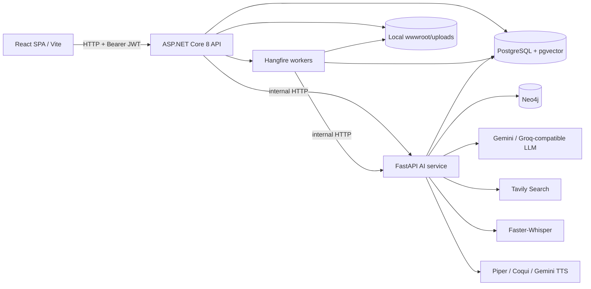
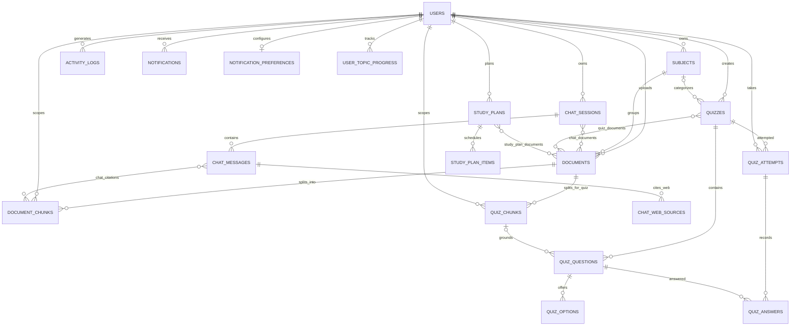

# GenT / Agentic AI Tutor: Architecture and Codebase Guide

**Review baseline:** repository source inspected on 2026-10-03. This document describes code present in this checkout, not every feature described in older project prose. It is a source-level architecture map; it does not claim that external services, credentials, databases, or optional model weights are currently available.

## 1. Purpose and Scope

The application is a student-facing learning platform. It lets an authenticated user group course files into subjects, chat against selected course documents, inspect knowledge-graph context, generate and take MCQ quizzes, and view quiz-derived progress. Optional paths provide web search, speech transcription, and spoken responses.

The code is divided into three deployable processes:

1. **React/Vite frontend** (`Frontend/`): browser UI, routing, auth token storage, and calls to the .NET API.
2. **ASP.NET Core 8 API** (`Backend/AgenticAITutor/AgenticAITutor/`): identity and authorization boundary, relational domain operations, local file storage, Hangfire jobs, and orchestration of the AI service.
3. **FastAPI AI service** (`ai_service/`): document parsing/chunking/embedding, RAG and chat reasoning, Neo4j KG extraction/retrieval, quiz inference, speech, and web search.

The main relational store is PostgreSQL. It contains user/domain data and RAG content chunks, with `pgvector` vectors on RAG chunks. Neo4j stores graph entities and graph relationships. Uploaded documents and generated audio are files under the .NET app's `wwwroot/uploads` tree. AI service temporary downloads and STT input are transient files.

## 1.1 Product Difference and Student Value

EduMind should be presented as a **course-centered learning application**, not as a new general-purpose foundation model. ChatGPT, Gemini, and NotebookLM can also support document-based questions and may provide citations or study aids. The defensible difference is how EduMind connects a student's course library to tutoring, structured concept relationships, quiz attempts, and progress in one application.

| Dimension | EduMind AI in this repository | General assistants and notebook tools |
|---|---|---|
| Primary organization | Persistent student account with subjects, uploaded documents, chat sessions, quizzes and attempts. | Typically organized around general conversations or individual notebooks/workspaces; exact features vary by product. |
| Evidence | Chat requests are scoped to the signed-in user's selected session documents and can return chunk/page citations. | Some competing products also ground responses in uploaded sources and cite them. EduMind's distinction is connecting that evidence to the same subject and assessment workflow. |
| Concept relationships | A Neo4j graph is built from course chunks and can contribute entity/relationship context to tutor responses and the graph viewer. | A general assistant may explain relationships in text; EduMind stores and retrieves explicit graph relationships tied to the user's subject/document IDs. |
| Assessment workflow | Quiz generation, server-side option shuffling, scored attempts, answer review, history and progress aggregation are part of the same backend/domain model. | Other tools can generate quizzes or study material, but EduMind connects generated questions to stored course chunks and persistent attempts in this app. |
| Learning progress | Progress is calculated from persisted quiz scores and missed question concepts. | General chat alone does not provide this application's linked quiz-attempt records; other learning products may offer their own tracking. |
| Model ownership | Provider-configured external LLM calls are used for several operations. The optional local fine-tuned quiz model is absent from this checkout. | EduMind is not differentiated by owning a unique foundation model. Its current value is application workflow and course-data organization. |

### Why a student may choose it

- They want answers about their own lecture notes rather than an answer detached from the class materials.
- They want to inspect the cited source passage/page and use it to continue studying.
- They want to move from asking a question to seeing related concepts, practicing with questions from the same course content, and reviewing their results.
- They prefer course materials, chats, quizzes and their quiz history to remain organized by subject in one account.

EduMind is most useful when students have course files and want a repeatable study workflow. A general assistant may be more suitable for broad research or tasks outside those files. EduMind should not promise that answers are always correct or that it improves learning outcomes without comparative evaluation. Source citations make checking easier; they do not prove that a generated answer is correct.

### Reviewer-ready explanation

> “EduMind is a course-focused learning platform, not a replacement foundation model. Students organize their materials by subject, ask questions grounded in selected files, inspect citations and concept relationships, then generate and take quizzes from those materials. Quiz attempts and missed concepts feed a progress view. Other AI products may offer several of these features individually; our project brings them together around a persistent course library and student assessment workflow.”

## 1.2 Implementation in Plain Language

There are five cooperating implementation layers:

1. **Browser:** React pages and hooks collect input, show chat/quizzes/progress, and call the .NET API. JWTs are attached to protected requests.
2. **Application API:** ASP.NET controllers receive requests. Services enforce ownership/business rules; repositories and EF Core read/write PostgreSQL. Controllers do not directly call the model provider for document or quiz workflows.
3. **Background processing:** Hangfire runs long document and quiz jobs outside the browser request. The database records status so the UI can display progress or failure.
4. **AI service:** FastAPI exposes internal endpoints. Python parses/cleans/chunks files, calculates vectors, retrieves text/graph evidence, builds prompts, invokes configured model providers, and returns structured results.
5. **Storage/providers:** PostgreSQL stores users, metadata, chunks, embeddings and quiz/chat records; Neo4j stores graph structure; the .NET file tree stores originals/audio; external LLM, Tavily, Whisper and TTS components perform model/provider-specific operations.

For a document upload, the call chain is:

```text
React upload form
    -> .NET DocumentController
    -> DocumentService validates owner/subject/type/size/hash
    -> LocalFileStorageService writes the original; EF persists PENDING document
    -> Hangfire DocumentChunkingJob
    -> .NET DocumentChunkService calls FastAPI /extract/embed
    -> Python parser -> cleaner -> semantic chunker -> E5 embedding
    -> .NET persists content.document_chunks and copies quiz chunks
    -> Hangfire continuation calls FastAPI /chunk/
    -> Python reads PostgreSQL chunks -> KG extraction LLM -> Neo4j
    -> document processing statuses become COMPLETED or FAILED
```

For a document-grounded chat message, the call chain is:

```text
React Chat page/useChat
    -> .NET ChatMessageController (JWT identity)
    -> ChatMessageService validates session ownership and adds the user message
    -> FastAPI /chat/ receives user/session/allowed-document IDs
    -> Python history/intent processing -> dense pgvector retrieval
    -> grounded RAG answer + separately retrieved Neo4j answer
    -> answer fusion and citation/KG-context response
    -> .NET persists assistant message, citations and KG JSON
    -> React renders message, citations and graph context
```

For quizzes, the browser asks .NET to initiate a quiz; .NET validates its subject/documents and enqueues Hangfire; the job loads quiz chunks and calls FastAPI `/quiz/generate`; Python generates/validates questions; .NET persists questions/options and marks the quiz ready. Starting and submitting an attempt remain .NET operations so correct answers and scoring are server-controlled.

### What is implemented versus what should not be implied

| Topic | Current implementation boundary |
|---|---|
| Tutor retrieval | The production chat route uses dense vector retrieval plus separate KG retrieval/fusion. BM25, RRF and BGE reranking are implemented in the standalone `/search/` route, not currently in the chat call chain. |
| Citations and confidence | Chat returns chunk/page citations and persists them. Its confidence value is currently always `0.0`; do not present it as a calibrated confidence estimate. |
| Quiz Bloom metadata | The normal upload job copies RAG chunks to quiz chunks and assigns default `understand`/`definition` metadata with empty concepts/keywords. The separate `/quiz/process` endpoint has richer semantic/quality/LLM metadata processing but is not called by that upload job. |
| Quiz model | The code can load a local fine-tuned Qwen model if model files are supplied. Those files are absent here, so the configured external LLM fallback is required in this checkout. |
| Progress | Dashboard statistics are computed from stored quiz attempts and answers. “Mastery” is an average quiz score; it is not an independently validated cognitive or adaptive-learning model. |
| Grounding | Prompt rules request answers from retrieved course content and citations identify retrieved chunks. LLM output still needs verification against the cited material. |

These boundaries are part of the implementation explanation: the product combines established libraries and external model services behind its own student workflow; it does not claim that every advertised research pipeline is active on every runtime path.

## 2. Runtime Architecture



### Request trust boundaries

- The browser sends credentials only to the .NET API. Protected controllers derive `userId` from the validated JWT rather than trusting the body for ownership.
- The .NET API checks ownership of sessions, subjects, and documents, then sends user/session/document identifiers to Python. Python itself has no JWT authentication layer in the inspected routers; it trusts the caller-supplied identifiers and should be treated as an internal service behind a network boundary.
- Python accesses PostgreSQL directly for RAG and KG metadata, in addition to the .NET API using EF Core against the same PostgreSQL database.
- Graph and relational writes are not one distributed transaction. For example, document deletion attempts graph cleanup and then proceeds with file/relational deletion even if graph cleanup fails.

## 3. End-to-End Processes

### 3.1 Registration, login, and authorization

1. `AuthController` accepts registration/login; the frontend's `authService` posts to `/api/Auth/register` or `/api/Auth/login`.
2. `AuthService` lowercases the email, checks uniqueness or verifies the stored password hash, and persists user changes through `IUserRepository`.
3. `BCryptPasswordHasher` hashes/verifies passwords. On success the service creates a signed HMAC-SHA256 JWT containing email and the user identifier in the `jti` claim; issuer, audience, signing key, and expiry are configured from `JWT` settings.
4. The browser stores the token and a small session object in `localStorage` (`auth_token`, `auth_session`). `apiClient` attaches `Authorization: Bearer ...` for authenticated requests. A 401 clears local session and redirects to `/`.
5. Forgot-password generates a cryptographically random six-digit OTP, records a 15-minute expiry, and enqueues email delivery through Hangfire. The public response is deliberately generic to reduce account enumeration. Reset verifies the OTP with a fixed-time byte comparison and replaces the BCrypt hash. Authenticated password change verifies the old password first.

### 3.2 Subject and document ingestion

1. The user creates a subject through `POST /api/Subject`. The service lowercases names; the database has a unique `(user_id, name)` constraint.
2. The frontend uploads a file as multipart form data to `POST /api/Document`. The API takes the effective user ID from the JWT. The service accepts `.pdf`, `.docx`, `.txt`, and `.pptx` up to 10 MiB, computes SHA-256, rejects duplicate content for the same user, verifies subject ownership, and saves the binary under `wwwroot/uploads/{userId}/{subjectId}/{guid}{extension}`.
3. It inserts a `content.documents` record with `PENDING` RAG, quiz, and KG processing statuses, then enqueues `DocumentChunkingJob.ChunkDocument`; a Hangfire continuation queues `KGChunkDocument` after the primary job succeeds.
4. The primary job marks RAG and quiz processing `PROCESSING`, then calls `DocumentChunkService.ChunkDocumentAsync`. .NET asks FastAPI `POST /extract/embed` to download the document through the API's file URL and parse, clean, semantically chunk, and embed it. Returned chunk text, page interval, and 768-dimensional vector are saved in `content.document_chunks`.
5. In the same job, `QuizChunkDocumentAsync` reads those RAG chunks in page/time order and copies each to `content.quiz_chunks`. **The integrated path currently assigns fixed metadata** (`bloom_level="understand"`, `chunk_type="definition"`, empty concepts/keywords); it does not call the separate Python `/quiz/process` preprocessing route. On success statuses become `COMPLETED`; exceptions mark RAG and quiz status `FAILED` and are rethrown.
6. The KG continuation requires RAG status `COMPLETED`, sets `kg_status=PROCESSING`, and calls FastAPI `POST /chunk/`. That endpoint resolves the document's subject/user in PostgreSQL, reads persisted RAG chunks, re-chunks their combined text for KG, extracts entities/relations per chunk with an LLM, stores them in Neo4j, and uses per-document checkpoint files to resume interrupted extraction. It returns a status payload; .NET marks KG completed/failed.
7. Failed primary processing can be retried with `/api/Document/{id}/retry-processing`; the service clears partial RAG and quiz chunks, resets status, and queues processing again. KG failure has a distinct status and is handled separately.

**Supported parser behavior:** PDF parsing uses PyMuPDF text extraction and optional OCR for scanned/embedded images; DOCX reads paragraphs/tables and can OCR images; PPTX reads text boxes and can OCR pictures; TXT tries UTF-8 then Latin-1; CSV joins cell values with separators. The parser module currently assigns a Windows Tesseract executable path in code. URL fetching in Python permits only supported extensions, has a 10 MiB streaming cap and timeout, and includes private-network/SSRF checks with an opt-in local-development bypass.

### 3.3 Document-grounded chat

1. A chat session is created with a user-owned set of document IDs. `ChatSessionService` rejects any selected document not belonging to the authenticated user and persists the session-document many-to-many links.
2. `ChatMessageController.SendMessage` requires `searchWeb=false`. The service revalidates session ownership, derives allowed document IDs from persisted session links, stores the user message, updates session time, and calls Python `POST /chat/`.
3. Python confirms the session exists, classifies greeting intent, loads up to 10 prior messages, asks an LLM whether the current message depends on that history, rewrites dependent questions, normalizes the query, classifies complexity, and decomposes complex questions into sub-questions. Failures in these helper LLM calls generally fall back to the original/simple path.
4. For each sub-question, Python embeds with the E5 query prefix and searches `content.document_chunks`, filtered by user and (when non-empty) allowed document IDs. It drops matches below `SIMILARITY_THRESHOLD` (default `0.5`), deduplicates by chunk ID, sorts by vector score, and retains at most five chunks. In this integrated chat path, this is dense retrieval; it does not call the `/search` endpoint's BM25/RRF/cross-encoder chain.
5. If chunks remain, Python builds a maximum ~6,000-character context and asks the chat LLM to answer using only that material and the selected language. Separately, it resolves the session's majority subject, extracts query entities, retrieves a hop-bounded graph subgraph restricted to user/subject/documents, focuses it for the question, and generates a KG-grounded answer. KG failure is non-fatal.
6. `fuse_answers` returns the available grounded answer when the other source says “I don't know”, or asks the chat LLM to combine both answers. Citations refer to retrieved document chunk IDs and page ranges. The current chat service explicitly returns `confidence_score=0.0`; a meaningful score is not presently computed.
7. .NET maps the response, stores the assistant message, serialized KG context, confidence, and many-to-many chunk citations. `GET /api/ChatMessage/{sessionId}` returns the conversation with citations and web sources.

### 3.4 Retrieval endpoint separate from integrated chat

FastAPI `POST /search/` implements a second retrieval path:

- Dense candidate search uses E5 embeddings and pgvector cosine distance.
- Sparse candidates use the Python `rank_bm25` `BM25Okapi` index, built from a user's chunks fetched from PostgreSQL.
- Reciprocal Rank Fusion combines ranked candidates with `k=60` using `1/(k+rank)`.
- `BAAI/bge-reranker-base` cross-encoder reranks the fused candidate list.

The current BM25 corpus/index is held in process-global variables for one `bm25_user_id` at a time; switching users rebuilds it. This endpoint's hybrid ranking should not be conflated with the `/chat/` retrieval behavior above. The standalone `/rag/` route also exists; it uses dense DB retrieval, a `0.5` similarity threshold, reranking, a short strictly grounded answer prompt, and page citations.

### 3.5 Knowledge graph lifecycle

The Neo4j schema is initialized from FastAPI startup (`init_kg_schema`, failure is non-fatal). Structural nodes are `(:User)`, `(:Subject)`, and `(:Document)`, joined by `HAS_SUBJECT` and `HAS_DOCUMENT`; extracted `(:Entity)` nodes are attached to documents by `HAS_ENTITY`. Entity uniqueness is `(name, document_id, user_id)`. Semantic relations become relationship labels (for example `CALLS`, `INHERITS_FROM`, `TREATS`); cross-document edges include types such as `PREREQUISITE_TO`, `BUILDS_UPON`, and `CONTRASTS_WITH`.

KG extraction prompts detect a broad academic domain, require directional and domain-specific relations, reject generic predicates, and pass the previous chunk tail to the next extraction to support cross-chunk links. The graph store sanitizes dynamic relationship labels before inserting them into Cypher. Graph retrieval uses LLM entity recognition plus optional fallback text hints, exact/flexible seed matching, subject/user/document scope, and a configurable hop count (default 2). `focus_subgraph_for_query` further caps a graph context to relevant seeds/neighbors (default max 28 entities). The chat UI visualizes returned nodes and edges; it does not query Neo4j directly.

There are two KG entry paths: integrated document processing uses `/chunk/` over already-persisted chunks, while `/kg/build` accepts a file upload and independently parses/chunks before KG extraction. `/kg/build-cross-doc` builds subject-level document pair relationships. KG deletion routes support document and subject cleanup.

### 3.6 Quiz generation and exam lifecycle

1. `POST /api/Quiz/initiate` checks subject ownership, document ownership, and that both RAG and quiz chunk statuses are complete. `GenerationHashService` hashes the user ID, sorted document IDs, and requested question count. A ready quiz with the same hash is reused; an in-progress one returns conflict; a failed one is deleted and regenerated.
2. The API stores the quiz as `GENERATING`, associates selected documents through `quiz.quiz_documents`, and enqueues `QuizGenerationJob`.
3. The job loads `content.quiz_chunks` for each selected document and sends chunk text/context/metadata to Python `POST /quiz/generate`. It requests `McqsPerChunk=1`. The AI creates one or more candidate slots using concepts, Bloom progression, chunk form, and keywords; deterministically selects slots to favor chunk/Bloom/concept diversity; generates MCQs; parses/validates structure; retries a failed slot once; shuffles options; and removes near duplicates.
4. Python uses a local merged Qwen fine-tuned model if the repository-relative `mcq-bloom-qwen-merged` directory exists. It does **not** exist in this checkout. Without it, generation uses the configured Gemini or Groq-compatible fallback provider. The default provider is Gemini and requires the quiz-specific key unless changed.
5. The .NET job maps the response's `mcqs` list into quiz question/option entities, stores them, and marks the quiz `READY`; on failure it marks `FAILED`. Question source chunk, concept, Bloom level, explanation, four labeled options, and the correct original label are persisted.
6. `GET /api/Quiz/{quizId}/start` creates a `quiz_attempts` row and shuffles the options per question using a seeded Fisher-Yates procedure. Only displayed option labels/text are returned; the correct answer stays server-side. A `shuffle_mapping` JSON object maps the shuffled labels back to original labels.
7. `POST /api/Quiz/{quizId}/submit` validates attempt ownership, is idempotent after submission, maps submitted labels back, scores against stored correct labels, stores each answer keyed by `(attempt_id, question_id)`, and stores percentage and finish time. `/attempt/{attemptId}/review` returns selected/correct answers, explanation, concept, Bloom level, and options.

The standalone FastAPI `/quiz/process` pipeline is different: it performs quiz-specific cleaning, semantic chunking, quality scoring/validation, and Groq metadata extraction with model rotation. It returns enriched chunks but does not persist them. It is not called from the integrated .NET upload job described above.

### 3.7 Web, audio, and progress

- **Web search:** `/api/ChatMessage/SearchWeb` stores the user message, then calls Python `/web-search`. Python reuses chat history for dependent-query rewrite, searches Tavily (up to five results), normalizes sources, and localizes the answer where needed. .NET persists the assistant answer as role `web` and source URLs/domains/titles in `rag.chat_web_sources`.
- **STT:** the authenticated .NET endpoint checks file extension and size (10 MiB), forwards multipart data to FastAPI `/audio/stt`, and returns only transcript text. Python stages a temporary audio file, calls Faster-Whisper `medium` (CPU/int8 by default; CUDA is optional), normalizes English/Kannada/Hindi/Malayalam/Tamil/Telugu, then removes the temporary file.
- **TTS:** .NET verifies the message's owning session and reuses a cached file if the stored audio URL matches the requested language. Otherwise it sends sanitized text to `/audio/tts`, stores returned WAV bytes below the user's/session's upload directory, updates the message audio URL, and deletes an older cached file. English uses `HybridTTS` (Piper by default, Coqui path for Arabic detection); non-English supported languages use Gemini TTS. Note that the exposed language list is English plus five Indian languages, while the local hybrid engine's detector only distinguishes English and Arabic.
- **Analytics:** `/api/Analytics/progress` aggregates a user's quiz attempts: total attempts, distinct subjects, average score as mastery, last-six-month monthly means, subject averages, estimated study time (fixed 15 minutes per attempt), and up to five most frequently missed concepts. It derives from quiz attempts/answers, not a separately trained mastery model.

## 4. PostgreSQL Physical Data Model

The checked-in DDL is [`schema.sql`](Backend/AgenticAITutor/AgenticAITutor/schema.sql); EF Core mappings are in [`AppDbContext.cs`](Backend/AgenticAITutor/AgenticAITutor/Data/AppDbContext.cs) and entity classes under `Models/`. UUID primary keys generally default to `uuid_generate_v4()`. Timestamps are `timestamp without time zone` in the DDL. The vector extension is enabled, and RAG embeddings are `vector(768)`.

### 4.1 Core tables and columns

| Schema/table | Columns and purpose |
|---|---|
| `auth.users` | `id` UUID PK; `first_name`, `last_name`, `email` (unique), `password_hash`; `role` (default `user`); `created_at`, `last_login`; password-reset `password_reset_otp`, `otp_expiry_time`. |
| `content.subjects` | `id` UUID PK; `name`; `user_id` FK to user. Unique `(user_id,name)` makes subject names user-scoped. |
| `content.documents` | `id` UUID PK; `user_id`, `subject_id`; original filename, file type, size, storage path, 64-character SHA-256 content hash, upload time; `processing_status`, `kg_status`, `quiz_chunking_status`. Unique `(user_id,content_hash)` prevents duplicate per-user uploads. |
| `content.document_chunks` | `id` UUID PK; nullable `document_id`, `subject_id`, `user_id`; `chunk_text`; `page_start`, `page_end`; `created_at`; `embedding vector(768)`. Used for dense RAG and citations. |
| `content.quiz_chunks` | `id` UUID PK; nullable document/subject/user FKs; `chunk_index`, `chunk_text`, adjacent context sentences, semantic/quality scores, Bloom level, chunk type, `concepts text[]`, `keywords text[]`, creation time. Used as quiz generation input. |
| `rag.chat_sessions` | `id` UUID PK; nullable `user_id`; `started_at`, title (default `New Chat`), `updated_at`. |
| `rag.chat_messages` | `id` UUID PK; required session FK, role, content; nullable confidence score, creation time, audio URL, `kg_context jsonb`. Roles used include `user`, `assistant`, and `web`. |
| `rag.chat_web_sources` | `id` UUID PK; nullable message FK; title, URL, domain. A message can have many sources. |
| `rag.chat_documents` | Composite PK `(session_id,document_id)`; session/document association for session-scoped evidence. |
| `rag.chat_citations` | Composite PK `(message_id,chunk_id)`; assistant-message to retrieved chunk association. |
| `quiz.quizzes` | `id` UUID PK; nullable user/subject; create/generated timestamps; `generation_hash`; status; question count. Unique `(user_id,generation_hash)` is the idempotency/cache key. |
| `quiz.quiz_documents` | Composite PK `(quiz_id,document_id)`; documents used for a quiz. |
| `quiz.quiz_questions` | `id` UUID PK; nullable quiz FK; question text, correct option label, explanation, concept, Bloom level, slot index, nullable source `chunk_id` FK to `content.quiz_chunks`. |
| `quiz.quiz_options` | `id` UUID PK; nullable question FK; option label and text. Normally four rows/question. |
| `quiz.quiz_attempts` | `id` UUID PK; nullable quiz/user FKs; score, start/finish timestamps, attempt number, `shuffle_mapping jsonb`. |
| `quiz.quiz_answers` | Composite PK `(attempt_id,question_id)`; selected option and correctness. One row per answered question in an attempt. |
| `planner.study_plans` | `id` UUID PK; nullable user FK; start/end dates and creation time. |
| `planner.study_plan_items` | `id` UUID PK; nullable plan FK; concept reference, estimated time, scheduled date, completion flag. |
| `planner.study_plan_documents` | Composite PK `(plan_id,document_id)`; plan/document association. |
| `public.activity_logs` | `id` UUID PK; nullable user FK; action, `metadata jsonb`, timestamp. |
| `public.notifications` | `id` UUID PK; nullable user FK; title, message, type, read flag, creation time. |
| `public.notification_preferences` | `user_id` PK/FK; nullable reminder, weak-topic, quiz, and progress flags (DDL defaults all to true). |
| `public.user_topic_progress` | Composite PK `(user_id,concept_ref)`; mastery score and last-updated time. This entity exists in the schema but is not updated by the inspected quiz grading/analytics service. |

### 4.2 Entity relationships



`|{`/`o{` in the diagram represent one-to-many/optional-many relationships; `}o--o{` means a many-to-many join table. Cascades are set on most user/session/document/quiz-owned data; deleting a document may therefore remove its chunks and association rows. Deleting a quiz cascades to questions/attempts/options/answers through the configured FK graph. A quiz's subject is `ON DELETE SET NULL` in DDL.

### 4.3 Important database implementation notes

- The DDL creates ordinary B-tree indexes for foreign keys, status/history lookups, and the uniqueness constraints above. No `HNSW`, `IVFFlat`, `tsvector`, or PostgreSQL full-text-search index is defined in the checked-in DDL or inspected application initialization. BM25 is Python `rank_bm25`, not PostgreSQL FTS.
- SQL `schema.sql` includes legacy, quoted public join tables (`ChatMessageDocumentChunk`, `ChatSessionDocument`, `DocumentQuiz`, `DocumentStudyPlan`) in addition to the newer schema-qualified join tables. Current EF mappings expect `rag.chat_citations`, `rag.chat_documents`, `quiz.quiz_documents`, and `planner.study_plan_documents`.
- `schema.sql` is a DDL snapshot, not an EF migration history. Startup creates extensions/schemas then calls `EnsureCreated`; `EnsureCreated` is not a migration system and does not incrementally reconcile an already-created database. Existing deployments need explicit schema versioning/migration discipline.

## 5. Neo4j Graph Model

| Label/relationship | Meaning and key properties |
|---|---|
| `(:User {id})` | User boundary; `id` unique. |
| `(:Subject {id,name,user_id})` | Subject owned by a user; unique `id`, indexed `user_id`. |
| `(:Document {id,filename,subject_id,user_id,doc_order})` | Source lecture/document; unique `id`, indexed subject. |
| `(:Entity {name,type,document_id,subject_id,user_id,...})` | Extracted educational concept/fact; unique `(name,document_id,user_id)`, indexed subject/user/document. |
| `HAS_SUBJECT`, `HAS_DOCUMENT`, `HAS_ENTITY` | Structural ownership and provenance paths. |
| Domain labels such as `CALLS`, `INHERITS_FROM`, `CAUSES`, `TREATS`, `DEFINED_BY` | Directed semantic entity-to-entity facts. The relation label itself carries predicate type. |
| `CROSS_DOC_RELATES` and typed cross-document semantic edges | Entity-level links across documents, with relation type/provenance metadata. |
| `CROSS_DOC_REL` | Document-level edge representing a cross-lecture relation. |

The canonical graph is built from extraction results, not stored as a second copy of every RAG vector/chunk. PostgreSQL remains the source for user/document identity, chunk text and citations; Neo4j provides entity/relationship topology. KG checkpoint progress is stored in JSON files beneath `ai_service/app/.kg_checkpoints/`, not a relational checkpoint table.

## 6. HTTP API Surface

The public browser-facing API is the .NET API (`/api/...`). All listed routes except registration/login/forgot/reset password require a Bearer token unless otherwise noted.

| Area | Routes |
|---|---|
| Auth | `POST /api/Auth/register`, `/login`, `/forgot-password`, `/reset-password`; authenticated `POST /change-password`. |
| User | `GET/PUT /api/User/profile`; `DELETE /api/User/profile`. |
| Subjects | `GET/POST /api/Subject`; `GET/PUT/DELETE /api/Subject/{id}`; `GET /api/Subject/{id}/documents/dropdown`. |
| Documents | `GET/POST /api/Document`; `GET/PUT /api/Document/{id}`; `DELETE /api/Document/{id}`; `GET /api/Document/subject/{subjectId}`; `GET /api/Document/{id}/download`; `POST /api/Document/{id}/retry-processing`. |
| Chunk inspection | `GET /api/DocumentChunk/{documentId}`. |
| Chat sessions/messages | `GET/POST /api/ChatSession`; `PUT /api/ChatSession`; `DELETE /api/ChatSession/{sessionId}`; `GET /api/ChatMessage/{sessionId}`; `POST /api/ChatMessage/SendMessage`; `POST /api/ChatMessage/SearchWeb`; `POST /api/ChatMessage/STT`; `POST /api/ChatMessage/{messageId}/TTS`. |
| Quizzes | `POST /api/Quiz/initiate`; `GET /api/Quiz/{quizId}/status`, `/start`, `/attempts`; `POST /api/Quiz/{quizId}/submit`; `GET /api/Quiz/attempt/{attemptId}/review`; `GET /api/Quiz/history`; `GET /api/Quiz/subject/{subjectId}`. |
| Analytics | `GET /api/Analytics/progress`. |

FastAPI is an internal AI API with OpenAPI at `/docs`. Routers mount `/extract/` and `/extract/embed`, `/chunk/`, `/search/`, `/rag/`, `/chat/`, `/web-search`, `/kg/...`, `/audio/stt`, `/audio/tts`, voice routes under `/voice/...`, and quiz routes `/quiz/process` and `/quiz/generate`. Exact subpaths and request models are defined in each router module. Python CORS is configured broadly; it is not an authentication substitute.

## 7. Module-by-Module Guide

### 7.1 Python AI service (`ai_service/app`)

| Module(s) | Responsibility |
|---|---|
| `main.py` | FastAPI construction, lifespan Neo4j schema initialization, CORS/static mounting, router registration and service version. |
| `router.py`, `parsers.py`, `file_loader.py` | File type/existence validation, parser dispatch, PDF/DOCX/PPTX/TXT/CSV extraction, optional OCR, secure URL download and temporary-file cleanup. |
| `text_cleaner.py`, `chunker.py` | Unicode/OCR/page marker cleanup and sentence-level semantic boundary detection. RAG chunker uses MiniLM for boundaries; page placeholders become chunk page ranges. |
| `extract.py` | Stateless `/extract` and `/extract/embed` endpoints; returns chunks or chunk text/page metadata/E5 vectors; does not persist them. |
| `embedding.py` | Loads `intfloat/e5-base-v2`; prefixes query/passages as required, normalizes vectors, returns Python lists. Its output width matches database `vector(768)`. |
| `db.py` | SQLAlchemy engine/session maker. Reads `DATABASE_URL` from environment/dotenv. |
| `vector_store.py` | Raw SQL reads of `content.document_chunks`; pgvector cosine-distance sort, optional user/document filters, filename join; exposes user chunk retrieval for BM25. |
| `search.py` | Dense retrieval + per-process BM25 + RRF + reranking endpoint. BM25 tokenization is lowercase word regex. |
| `reranker.py` | Lazy `CrossEncoder` singleton for `BAAI/bge-reranker-base`; scores `(question, title+passage)` pairs and sorts top-k. |
| `rag.py`, `rag_service.py` | Standalone grounded QA API; context assembly, thresholding, reranking, prompt restrictions and “I don't know” fallback. |
| `chat.py`, `chat_service.py` | Chat request/response contracts and integrated turn orchestration: session check, intent, history dependency, rewrite, complexity/decomposition, dense evidence, KG answer, fusion and citation payload. |
| `llm.py` | OpenAI-compatible completion adapter, provider/model configuration, categorized failures, retries/backoff, fallback model chains, and feature-specific Gemini key resolution. Chat/KG/quiz can select different providers and settings. |
| `language_config.py` | Supported language codes, Whisper codes, localized IDK text, response language instructions. |
| `chunk_kg.py` | Reads PostgreSQL chunks for a document, KG-specific re-chunking, checkpoint resume, per-chunk extraction, Neo4j persistence and cross-document matching. |
| `kg.py` | KG HTTP routes for full upload build, subject-level cross-document build, subgraph/answer queries, retrieval/list/status/deletion operations. |
| `kg_pipeline.py` | KG upload parse-clean-chunk pipeline; reuses the RAG parser/cleaner/chunker without DB writes. |
| `kg_service.py` | Validates relational IDs, builds/deletes graph, extracts query entities, scopes/focuses subgraphs, creates natural-language KG answers and fuses RAG/KG answers. |
| `kg_extractor.py` | Prompt templates, domain-specific entity/relation extraction, JSON parsing, chunk-context handling, and cross-document relation extraction. |
| `kg_store.py` | Neo4j MERGE/upsert/query/delete operations plus PostgreSQL identity/chunk lookups. It sanitizes relation labels before interpolating Cypher identifiers. |
| `kg_db.py` | Neo4j Bolt driver singleton, credentials, session creation, startup uniqueness constraints and indexes. |
| `kg_checkpoint.py`, `kg_chunker_config.py`, `kg_chunking_strategy.py` | File-backed incremental KG status/checkpoint persistence, chunk-size policy, and KG-optimized re-chunking strategy. |
| `quiz/quiz_router.py` | Standalone file-to-quiz-chunk API; validation, quiz cleaning/chunking and metadata extraction; returns chunks only. |
| `quiz/quiz_cleaner.py`, `quiz/quiz_chunker.py`, `quiz/quiz_config.py` | Quiz-oriented cleaning, semantic chunking, context fringe, score/quality gates and defaults. |
| `quiz/quiz_metadata.py` | Batched Groq metadata extraction for usability, Bloom level, chunk type, concepts and keywords; model rotation/backoff and safe defaults. |
| `quiz/quiz_generate_router.py` | Pydantic-validated MCQ generation request, slot pipeline orchestration, trace logging and response envelope. |
| `quiz/quiz_prompt_builder.py` | Prompt creation and slots per chunk/concept, Bloom progression, key context/metadata conditioning. |
| `quiz/quiz_slot_selector.py` | Deterministic diversity selector prioritizing chunk coverage, underrepresented Bloom levels, novel concepts, then slot type. |
| `quiz/quiz_generator.py` | Lazy model load, local/fallback inference, robust JSON/plain-text parsing, Pydantic validation, retry, answer-option shuffling, deduplication and output mapping. |
| `vstt.py`, `audio/stt.py` | STT API boundary, temporary upload handling, Faster-Whisper inference and transcript confidence computation. |
| `vtts.py`, `audio/hybrid_tts.py`, `audio/tts.py`, `audio/xtts_tts.py`, `audio/normalize.py`, `audio/coqui_tts_compat.py` | Streaming TTS API, language/provider selection, local Piper/Coqui compatibility, and audio output normalization. |
| `voice.py` | Legacy/combined voice interaction endpoints; separate from the frontend's current STT then chat then TTS calls. |
| `web_search_chat.py`, `web_search_service.py` | History-aware query rewrite, Tavily request/source extraction, optional answer localization. |
| `evaluation/` | Offline dataset ingestion, chunk/search diagnostics, retrieval and generation evaluation (including RAGAS/TruLens-related scripts), dataset preparation/conversion. Not on the normal request path. |
| `db_inspector.py`, `get_ids.py`, `insert_test_chunk.py` | Development/debugging scripts for database inspection, ID lookup and fixture/test chunk insertion; not application endpoints. |
| `test_llm.py`, `test_ocr.py`, `test_search.py`, `test_stt.py`, `test_tts.py`, `test_voice.py` | Manual/in-module diagnostics. Automated test files also exist under `ai_service/tests/`. |

### 7.2 .NET API (`Backend/AgenticAITutor/AgenticAITutor`)

| Area | Modules and responsibilities |
|---|---|
| Host/wiring | `Program.cs` configures controllers, Swagger/JWT scheme, Npgsql + pgvector, dependency injection, Hangfire PostgreSQL storage (2 workers), named HttpClients/timeouts, upload limits, global IP fixed-window rate limiting, exception handling, logging, middleware and database initialization. |
| Controllers | `AuthController`, `UserController`, `SubjectController`, `DocumentController`, `DocumentChunkController`, `ChatSessionController`, `ChatMessageController`, `QuizController`, `AnalyticsController` expose HTTP contracts and translate claims/body/status to services. `MockAIController` is a development mock, not the production AI pipeline. |
| Background jobs | `DocumentChunkingJob` coordinates document chunks, quiz chunks, and KG continuation/status. `QuizGenerationJob` loads stored quiz chunks, calls AI generation, maps question/options, and transitions quiz state. |
| Services | Auth/password/email, subject/document/file storage, document chunks, session/message/web sources, quiz hash/generation orchestration, user profiles, and analytics. Interfaces separate controller consumers from implementations. |
| Repositories | EF Core database access per aggregate: users, subjects, documents, document chunks, sessions/messages/web sources, quizzes/quiz chunks, analytics. They encapsulate query shape and persistence operations. |
| Persistence | `Data/AppDbContext.cs` maps 20 DbSets and relations; partial mapping sets `DocumentChunk.Embedding` to `vector(768)`. Entity files in `Models/` reflect PostgreSQL columns; DTOs under `Models/DTOs` define wire contracts; enums hold processing/quiz statuses. |
| Validation/security | FluentValidation validators cover auth requests; `ClaimsPrincipalExtensions` extracts user ID; `JWT` holds settings; `BCryptPasswordHasher` hides BCrypt details behind `IPasswordHasher`; `GlobalExceptionHandler` produces central problem responses; Hangfire dashboard has an authorization filter. |
| Local infrastructure | `LocalFileStorageService` handles unique upload/audio paths, move/delete/existence; `SmtpEmailService` sends OTP mail; `DummyEmailService` is a test/development implementation. |

The request pipeline is: exception handler and HTTP logging, Hangfire dashboard, Swagger, HTTPS redirect, permissive configured CORS policy, static files, routing, rate limiter, JWT authentication, authorization, controller endpoints. The backend caps multipart and Kestrel request bodies at 10 MiB. The named quiz HTTP client has a long timeout; the source's Polly retry registration is commented out, so do not assume retries are active merely from comments.

### 7.3 React frontend (`Frontend/src`)

| Area | Modules and responsibilities |
|---|---|
| Bootstrap | `main.tsx` mounts React; `app/App.tsx` composes TanStack Query, theme, auth context, router, and toast provider. |
| Routing/layout | `app/routes.ts` defines public welcome/forgot/reset routes and protected dashboard/quiz routes; `ProtectedRoute` gates auth; `MainLayout` frames the signed-in workspace. |
| Pages | `Welcome`, `ForgotPassword`, `ResetPassword`; `Dashboard`, `Subjects`, `SubjectDetail`; `Chat`; `Quiz`, `QuizDetail`, `ActiveQuiz`, `QuizReview`; `Progress`, `Settings`, `Notifications`. Pages compose UI and call hooks/services; quiz review and active attempt are separate screens. |
| Reusable workflow components | Chat sidebar/input/message rendering, new-session modal, KG viewer; subject document/progress tabs; profile/password controls; responsive/theme helpers. `components/ui/` contains Radix/shadcn-style UI wrappers. |
| State/data hooks | `AuthContext` owns JWT/session state; `useChat`, `useSubjects`, `useSubjectDocuments`, `useUserProfile` wrap TanStack Query queries/mutations and cache invalidation/optimistic updates. |
| HTTP/services | `lib/apiClient.ts` handles JSON fetch, local token/session persistence, timeouts and 401 redirect. `services/` modules map auth, users, subjects, documents, chat, quizzes and analytics to API routes. Document uploads/audio use `authFetch` because they are multipart or binary. |
| Types/styles | `types/` contains frontend response/request contracts; `styles/` defines fonts, Tailwind, and theme CSS. `imports/` holds design-export source material, not business logic. |

Routes include `/`, `/login`, `/forgot-password`, `/reset-password`, protected `/dashboard/*`, and protected `/quizzes/*`. Quiz start/submit/review use the server attempt ID and shuffled labels. The frontend does not hold the correct answer until review response.

## 8. Technologies and Terms

| Term / technology | Meaning in this project |
|---|---|
| React 18, TypeScript, Vite | Browser SPA rendering, typed contracts and local development/build server. |
| React Router 7 | Client route tree, including protected routes. |
| TanStack Query 5 | Request/cache/mutation lifecycle, retries, optimistic message/session updates. |
| Radix UI/shadcn-style wrappers, Tailwind CSS 4, MUI, Lucide, Motion | UI primitives/styles/icons/animations; dependencies are listed in `Frontend/package.json`. |
| ASP.NET Core 8 Web API | Main application API, middleware, dependency injection and HTTP controllers. |
| EF Core 8, Npgsql, Pgvector | Relational object mapping and PostgreSQL/pgvector integration. |
| PostgreSQL, `uuid-ossp`, `vector` | Relational system of record, UUID generation and vector column type. |
| Neo4j, Cypher, Bolt | Property graph storage/query language/driver for knowledge graph facts. |
| FastAPI, Pydantic, Uvicorn | Python API server, request/response validation, ASGI hosting. |
| SQLAlchemy, psycopg2 | Python relational database connections/SQL access. The RAG retrieval code uses SQLAlchemy text queries. |
| Sentence Transformers | E5 passage/query vectors; MiniLM sentence embeddings for semantic chunk boundaries. |
| pgvector cosine distance | Dense nearest-neighbor ranking over persisted chunk vectors. |
| BM25 / RRF | Lexical relevance and rank-only fusion in the standalone `/search` endpoint. RRF contribution is `1/(60+rank)` per channel. |
| Cross-encoder | BGE reranker scores each query/passage pair jointly; heavier than vector search but used on a smaller candidate pool. |
| RAG | Retrieval-Augmented Generation: retrieve source chunks, place evidence in an LLM prompt, answer under grounding rules, return citations. |
| KG-RAG / knowledge graph | Entity and directed predicate graph used as a second answer/context source alongside text retrieval. |
| LLM | Large language model used for intent/rewrite/decomposition, answer generation/fusion, KG extraction and MCQ generation. Provider/model is feature-configurable. |
| Bloom's Taxonomy | Remember, understand, apply, analyze, evaluate, create cognitive-level metadata used in the independent quiz metadata/slot path. |
| Hangfire | Persistent background job scheduling backed by PostgreSQL; used for document processing, quiz generation, and email delivery. |
| JWT / BCrypt / OTP | Signed bearer-token auth, password hashing, and expiring one-time password reset workflow. |
| DTO | Data Transfer Object: request/response shape kept separate from EF entities. |
| RRF | Reciprocal Rank Fusion: combines rankings without requiring dense and lexical scores to share a numeric scale. |
| STT / TTS | Speech-to-text and text-to-speech. |
| OCR | Optical character recognition for scanned page/image text; implemented with Tesseract. |
| SHA-256 content hash | Per-user duplicate upload detection and deterministic quiz-generation hash construction. |
| Idempotency | Repeating quiz initiation can reuse an existing generation; repeating a completed attempt submission returns its original result. |
| Semantic chunking | Split text where sentence-embedding similarity drops, subject to chunk-size, sentence and noise constraints. |

### Selected declared dependencies

- Python `requirements.txt`: FastAPI/Uvicorn/Pydantic, PyMuPDF, python-docx/python-pptx, pytesseract/Pillow/pdf2image, sentence-transformers, Transformers 4.41.2, Torch/Torchaudio 2.1.2, SQLAlchemy/psycopg2, Neo4j, NLTK, rank_bm25, Faster-Whisper, TTS/Piper, OpenAI/Gemini/LangChain integrations, and evaluation libraries.
- .NET project: BCrypt.Net-Next, FluentValidation, Hangfire PostgreSQL, MailKit, ASP.NET JWT bearer, EF Core 8, Npgsql EF provider, Pgvector, Polly HTTP package, and Swashbuckle.
- Frontend dependencies are enumerated in `Frontend/package.json`; notably React, React Router, TanStack Query, Radix UI, MUI, Tailwind/Vite, React Markdown, charts, graph visualization and Lucide.

## 9. Configuration and Local Operation

`RUNNING_GUIDE.md` documents the intended local ports: AI `8001`, backend HTTP `5099`/HTTPS `7257`, frontend `5173`, PostgreSQL `5432`, Neo4j Bolt `7687`. Defaults are not perfectly aligned across all callers, so explicit configuration is important.

| Process | Important configuration keys read by code |
|---|---|
| .NET | `ConnectionStrings:DefaultConnection`; `JWT:Key`, `JWT:Issuer`, `JWT:Audience`, `JWT:DurationInDays`; `AIService:BaseURL` and route overrides (`ChunkingPath`, `KGChunkingPath`, `ChatPath`, `STTPath`, `TTSPath`, `WebSearchPath`, `McqGeneratePath`, KG deletion paths); `AppConfig:BaseURL`; email settings. |
| Python DB | `DATABASE_URL` is read by `app/db.py`; `NEO4J_URI`, `NEO4J_USER`, `NEO4J_PASSWORD` configure Neo4j. |
| Python LLM | `LLM_API_KEY`/`GROQ_API_KEY`/`OPENAI_API_KEY`, `LLM_URL`, `LLM_MODEL`; feature overrides include `CHAT_LLM_*`, `KG_LLM_*`, `QUIZ_LLM_*`, `GROQ_QUIZ_MODELS`, `GEMINI_CHAT_API_KEY`, `GEMINI_KG_API_KEY`, `GEMINI_QUIZ_API_KEY`, `GEMINI_TTS_API_KEY`; legacy fallback `GOOGLE_API_KEY`. |
| Other Python | `TAVILY_API_KEY` for web search; `SIMILARITY_THRESHOLD`; `WHISPER_DEVICE` and `WHISPER_COMPUTE_TYPE`; `ALLOW_INTERNAL_NETWORK` for explicit local URL-fetch bypass; TTS model/voice overrides. |
| Frontend | `VITE_API_BASE_URL` (defaults to `http://localhost:5099`). |

Local prerequisite services are PostgreSQL with `uuid-ossp` and `vector` extensions and Neo4j 5.x. Tesseract must be installed at the configured path or that path must be made configurable. Start PostgreSQL/Neo4j, FastAPI, .NET, then Vite. See the running guide for shell commands and example configuration shapes; do not place production secrets in tracked settings or frontend environment variables.

## 10. Verified Gaps, Drift, and Operational Risks

These observations explain current behavior and should be considered before relying on older README claims:

1. **Database variable name:** the running guide describes `POSTGRES_URL`, but Python `db.py` reads `DATABASE_URL`. Unless both are set or code is adjusted, the AI service's relational DB connection will not be configured as that guide suggests.
2. **Schema lifecycle:** backend startup runs `EnsureCreated`, not migrations. `schema.sql`, EF mappings, and runtime-created schemas must stay synchronized manually or with a separately managed migration process.
3. **Graph soft-delete predicate:** `kg_store.py` queries `content.documents.is_deleted=false`; the checked-in `schema.sql` and `Document` EF entity have no `is_deleted` column. KG ID validation/path resolution using that predicate can fail against this schema unless the deployed database has an untracked migration/column.
4. **Chat retrieval differs from advertised hybrid RAG:** `/search/` is dense+BM25+RRF+cross-encoder; the actual .NET chat route calls `/chat/`, whose current retrieval is filtered dense-only plus separate KG retrieval. Do not assume every chat response is BM25/cross-encoder ranked.
5. **Confidence is a placeholder:** integrated chat returns zero confidence score even when retrieved evidence exists; confidence described in project prose is not calculated in this path.
6. **Quiz preprocessing is split:** the independent `/quiz/process` endpoint performs semantic quiz chunking, scores, metadata extraction and usability filtering. The normal .NET upload pipeline instead copies RAG chunks into quiz chunks and stamps default metadata. Thus active quiz Bloom diversity can be limited to defaults unless data is enriched another way.
7. **Optional local model absent:** `mcq-bloom-qwen-merged` is absent from this checkout. Python quiz generation therefore requires a configured remote fallback provider/key (Gemini by default) unless the model is supplied.
8. **Declared Python package gaps to verify:** active code imports packages such as `groq`, `ftfy`, and `soundfile` that are not directly listed in the visible `requirements.txt`; they may arrive transitively in a particular environment, but should be declared explicitly for reproducible installation.
9. **BM25 cache scope:** the `/search/` BM25 index is a mutable process-global cache for one user at a time. Concurrent requests for different users may cause rebuild/selection races; a per-user cache with bounded lifetime or an external search index would be safer at scale.
10. **Index claims:** the physical DDL has normal relational indexes and a vector column but no HNSW/IVFFlat or PostgreSQL FTS definitions. Search performance characteristics should not be described as an indexed HNSW/FTS deployment until those indexes are provisioned and verified.
11. **Python service perimeter:** FastAPI routes accept identity/document IDs directly and enable wildcard CORS. They should be private to the backend or protected by service authentication/network policy; CORS alone is not access control.
12. **OCR portability:** `parsers.py` hardcodes a Windows Tesseract path. Linux/container deployments need an environment-based executable path and installed OCR binary.
13. **HTTP resilience:** `Program.cs` includes a Polly HTTP package and comments describing retries, but the shown retry policy registration is commented out. Timeouts exist; automatic retries are not guaranteed.
14. **Physical cleanup is best effort:** KG deletion errors are swallowed before relational/file hard deletion. A failed Neo4j cleanup can leave orphan graph nodes; a durable cleanup job/outbox and reconciliation process would make deletion reliable.
15. **Secrets:** use environment/user secrets/secret manager for DB, JWT, SMTP, Gemini, Groq, OpenAI and Tavily credentials. This document intentionally reproduces no secret values.

## 11. Testing and Documentation Boundaries

The repository includes two focused Python tests under `ai_service/tests/` for Gemini key routing and quiz model rotation, several manual diagnostic scripts under `ai_service/app/`, a broad evaluation toolkit under `ai_service/app/evaluation/`, and the frontend build script (`npm run build`). The current architecture review did not execute external-service integration tests; those require PostgreSQL, Neo4j, model/provider credentials, OCR binaries and possibly model weights. The frontend build had already completed successfully in the current workspace context.

This is one architecture reference for the application source. It does not inventory generated `node_modules`, build output, uploaded sample files, every experiment notebook/dataset, or every line of each third-party package. For an implementation decision, the linked source/DDL remains authoritative where runtime configuration and this summary diverge.